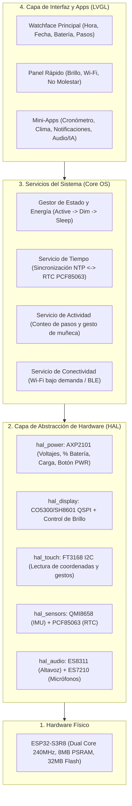
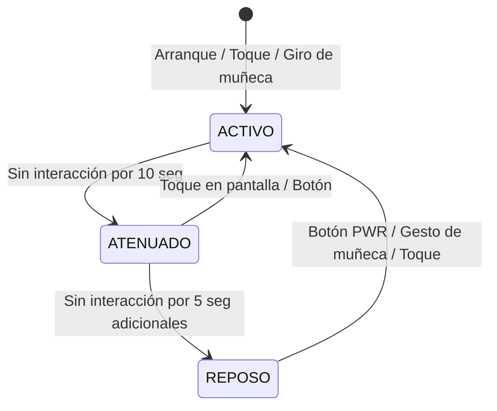

# 05. Arquitectura de Software de Nuestro Smartwatch

Para que nuestro reloj inteligente sea **rápido, estable, mantenible y nunca se convierta en un archivo gigante imposible de depurar**, diseñaremos el firmware siguiendo una **Arquitectura Modular por Capas**.

Si algún día queremos cambiar el diseño del reloj (Watchface) o agregar una aplicación nueva, solo tocaremos la capa de interfaz (`ui/`) sin riesgo de romper el controlador de batería o la pantalla.

---

## 1. Diagrama de Arquitectura en Capas



---

## 2. Estructura de Carpetas del Código (`firmware/`)

```text
G:\ITM\reloj-inteligente\firmware\
├── config\
│   └── pins_config.h          # Todas las constantes de pines GPIO y direcciones I2C en un solo lugar
├── hal\                       # Capa de Hardware (Hardware Abstraction Layer)
│   ├── hal_power.h / .cpp     # Inicialización segura del AXP2101 y lectura de batería
│   ├── hal_display.h / .cpp   # Inicialización QSPI AMOLED y ajuste de brillo (0-255)
│   ├── hal_touch.h / .cpp     # Lectura táctil del FT3168
│   ├── hal_rtc.h / .cpp       # Lectura/escritura de hora en el chip PCF85063
│   └── hal_imu.h / .cpp       # Acelerómetro/giroscopio QMI8658 (pasos y giro de muñeca)
├── services\                  # Lógica de negocio del reloj
│   ├── power_manager.h / .cpp # Máquina de estados de energía (encendido, ahorro, reposo)
│   └── time_sync.h / .cpp     # Sincronización de hora exacta por Wi-Fi (NTP) hacia el RTC
├── ui\                        # Interfaz gráfica en LVGL
│   ├── ui_manager.h / .cpp    # Navegación entre pantallas (gestos swipe)
│   ├── screens\
│   │   ├── scr_watchface.cpp  # Pantalla principal del reloj hecha a medida
│   │   ├── scr_settings.cpp   # Ajustes de brillo, batería y sistema
│   │   └── scr_apps.cpp       # Aplicaciones personalizadas
│   └── assets\                # Fuentes tipográficas e iconos personalizados
└── main.ino (o main.cpp)      # Punto de entrada limpio: inicializa HAL, Servicios y bucle UI
```

---

## 3. Gestión Inteligente de Batería (Máquina de Estados)

Un verdadero reloj inteligente debe cuidar su batería y su pantalla AMOLED (evitando el *burn-in* y el consumo innecesario):



1. **Estado `ACTIVO`:**
   * Brillo de pantalla al nivel elegido por el usuario (ej. 80%).
   * LVGL refrescando a máxima fluidez (60 FPS).
   * CPU a 240 MHz.
2. **Estado `ATENUADO` (Dimmed):**
   * Si pasan 10 segundos sin tocar la pantalla, el brillo baja suavemente al 15%.
3. **Estado `REPOSO` (Screen Off / Light Sleep):**
   * Pasados otros 5 segundos, se apaga el panel AMOLED (`Brightness = 0` / comando `Display Off`).
   * Se reduce la frecuencia de la CPU (por ejemplo a 80 MHz o *Light Sleep*) manteniendo activo el conteo de pasos en el sensor **QMI8658** y la detección del botón `PWR` o toque para despertar en menos de 50 milisegundos.
   * El **Wi-Fi permanece apagado por defecto** y solo se enciende durante unos pocos segundos cuando se necesita sincronizar la hora NTP, consultar el clima o usar funciones de voz/IA.
